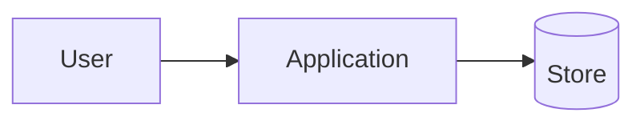

# Architecture

## Context

Describe the system boundary and the people or systems it talks to.

## Containers

| Container | Responsibility | Interface |
| --- | --- | --- |
| Application | Runs the product logic | HTTP / CLI |
| Store | Persists state | SQL / files |

## Components

- Component: responsibility; owned data; collaborators.

## Data model

- Entity: fields, invariants, lifecycle.
- What is the source of truth?

## Interfaces

- Interface: producer, consumer, contract, versioning, failure behaviour.

## Failure modes

- What fails? What does the user see? What is retried, what is rejected?
- What is the recovery path?

## Security

- Trust boundaries; authentication; authorization; secrets; data handling.

## Deployment

- Where it runs; how it is built; how it is configured; how it is rolled back.

## Observability

- Logs, metrics, traces, health checks, alerts, and who reads them.

## Open questions

- Question: owner; deadline.
